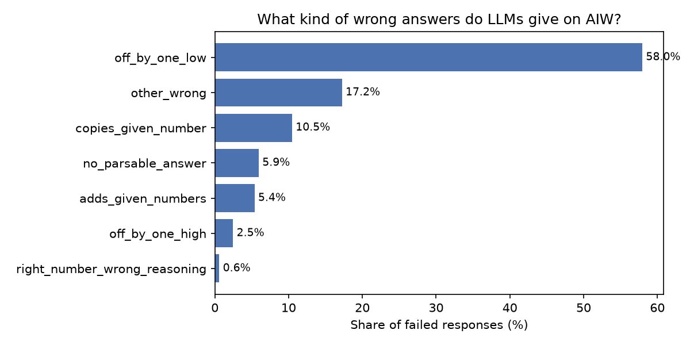

# Mining Failure Patterns of LLMs on the AIW Reasoning Benchmark

A data mining study of **49,838 answers from 75 large language models** to the
"Alice in Wonderland" (AIW) reasoning problems, such as:

> *Alice has 4 sisters and she also has 1 brother. How many sisters does Alice's brother have?*
> (Correct answer: 5, because Alice is also a sister.)

The project asks three questions:

1. **What kinds of wrong answers do models give?** A rule-based error taxonomy plus text clustering of failed responses.
2. **Which conditions go together with failure?** Association rule mining (Apriori) over prompt style, model family, size and response length.
3. **Can failure be predicted before the model answers?** Classifiers trained on prompt and model features only, evaluated with grouped cross-validation so no prompt or model leaks between train and test.

It applies the methods from the M.Sc. course *Data Mining Methods* (Frankfurt UAS) to a real
research question. The data comes from the AIW project by LAION-AI; see
[THIRD_PARTY_NOTICES.md](THIRD_PARTY_NOTICES.md).

## Main results (full dataset)

From [results/REPORT.md](results/REPORT.md), generated by the pipeline:

- Overall accuracy is **7.2%** (8.3% on the sibling problems, 2.0% on the harder cousin problems).
- **58.0%** of all failures, and **68.8%** of failures on the sibling problems, are exactly *one less than the right answer*. In these problems that means the model **forgot to count Alice herself**.
- Stronger models do **not** fail more consistently in this way: across 49 models, the rank correlation between accuracy and off-by-one share is **ρ = −0.058**. The error profile depends on the model family instead (see `results/figures/errors_by_family.png`).
- Predicting correctness for **unseen prompts**: knowing only how good each model is (`prior_by_model`) gives ROC-AUC **0.837**. Adding prompt features in a gradient boosting model gives ROC-AUC **0.845** (within noise) but raises PR-AUC from **0.314 to 0.453** and wins in 4 of 5 folds. So prompt features mainly help to find the rare correct answers.
- For **unseen models**, no method clearly beats the model-family prior (ROC-AUC about 0.68).



## Requirements

- Python **3.11 or newer** (uses the built-in `tomllib`)
- About 200 MB free disk space and an internet connection for the one-time data download
- Windows, macOS or Linux

## Installation

```bash
git clone <your-repo-url> llm-failure-mining
cd llm-failure-mining
python -m venv .venv
# Windows:  .venv\Scripts\activate
# macOS/Linux:  source .venv/bin/activate
pip install -r requirements.txt
```

## Quick start (sample data, about 10 seconds)

A 435-record sample of the real data is included, so you can try everything without downloading:

```bash
python -m llm_failure_mining.cli run --sample
```

Results go to `results/sample/`. Open `results/sample/REPORT.md`.

## Full run (about 40 seconds)

```bash
python scripts/fetch_aiw_data.py          # downloads 45 MB, verifies SHA-256
python -m llm_failure_mining.cli run
```

Expected console output (timings vary):

```
1/6 Loading .../data/raw/AIW_AIW_plus.json
    49838 responses, 75 models, 63 prompts
2/6 Descriptive statistics and error types
3/6 Clustering failed responses
    best k = 10
4/6 Mining association rules
    25 rules kept
5/6 Predicting failure with grouped cross-validation
6/6 Writing report
Done in 37.5 s. Report: .../results/REPORT.md
```

### Outputs in `results/`

| File | Content |
|---|---|
| `REPORT.md` | Full report with all tables and figures |
| `summary.json` | Accuracy and error-type shares |
| `error_types_by_model.csv`, `..._by_family.csv`, `..._by_style.csv` | Error-type breakdowns |
| `clusters.csv` | Failure clusters with top terms and examples |
| `rules.csv` | Association rules |
| `prediction_summary.csv`, `prediction_folds.csv` | Cross-validation results |
| `feature_importance.csv` | Permutation importance |
| `figures/*.png` | Charts |

## Run the tests

```bash
python -m pytest -q
```

46 tests cover feature extraction, data validation, rule mining, clustering,
leakage checks for the grouped split, an end-to-end run on the sample, and the
Ollama collector with a mocked server.

## Optional: add your own local models with Ollama

```bash
ollama pull llama3.2:3b
python -m llm_failure_mining.collect_ollama --model llama3.2:3b --trials 5
python -m llm_failure_mining.cli run --data data/collected/ollama_llama3.2_3b.json
```

The collector sends every distinct prompt from the sample to your local model
and saves the answers in AIW format. Results go to `results/ollama_llama3.2_3b/`.
This path was tested with a mocked server only; see [VERIFICATION.md](VERIFICATION.md).

## Configuration

Edit `config.toml` to change the random seed, the clustering range (`k_min`, `k_max`),
Apriori thresholds (`min_support`, `min_confidence`) or the number of folds.

## Troubleshooting

| Problem | Fix |
|---|---|
| `ModuleNotFoundError: tomllib` | Use Python 3.11 or newer |
| `Dataset not found` | Run `python scripts/fetch_aiw_data.py`, or use `--sample` |
| Download fails or checksum mismatch | Clone https://github.com/LAION-AI/AIW, check out commit `4d5d079`, copy `collected_responses/AIW_AIW_plus.json` to `data/raw/` |
| `Ollama request failed` | Start Ollama and pull the model first |

## Known limitations

- Only two problem families (siblings and cousins) and 63 prompt variants; findings may not transfer to other tasks.
- Prompt style and problem content are partly confounded, because not every style was run on every problem and model.
- Clusters are only weakly separated (silhouette about 0.16) and partly reflect problem wording; the rule-based error types are the more reliable signal.
- Correctness labels are the AIW authors' labels; we did not relabel any response.

## Documentation

- [PIPELINE_EXPLAINED.md](PIPELINE_EXPLAINED.md): how every part works, in plain English
- [PROFESSOR_DEMO.md](PROFESSOR_DEMO.md): five-minute demo script and likely questions
- [VERIFICATION.md](VERIFICATION.md): what was tested and the results
- [THIRD_PARTY_NOTICES.md](THIRD_PARTY_NOTICES.md): data source and licenses
