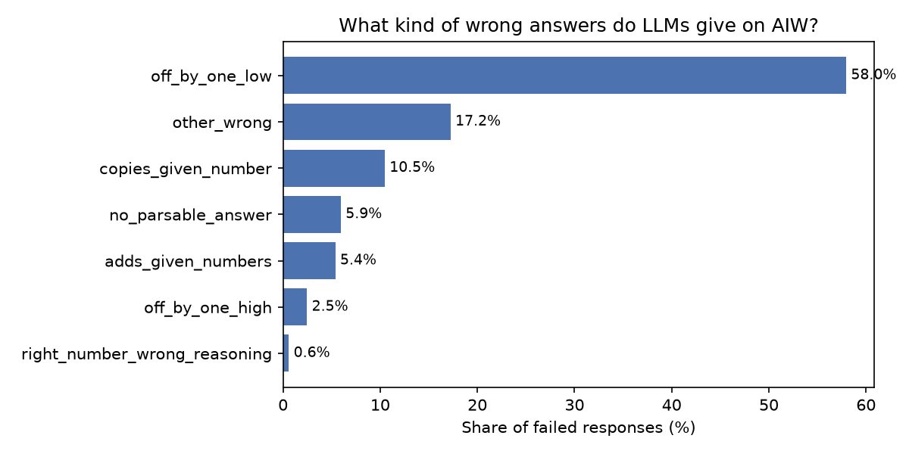
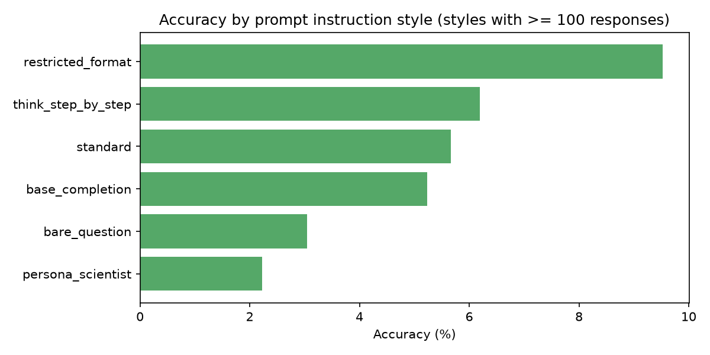
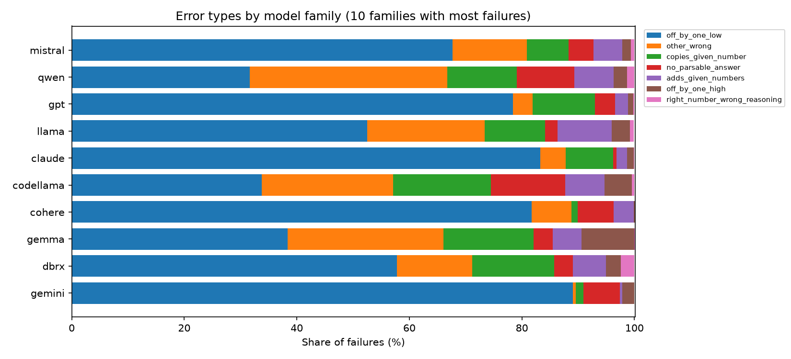

# Results Report

_Auto-generated by `python -m llm_failure_mining.cli run` on the **full** data. Every number below is computed by the pipeline; nothing is typed in by hand._

## Dataset
- Responses: **49,838** from **75** models on **63** prompts
- Records dropped by validation: 0
- Overall accuracy: **7.2%**
- Accuracy by problem type: aiw_plus_cousins 2.0%, aiw_siblings 8.3%

## Key finding 1: most failures are one specific mistake
Among all failed responses, **58.0%** give the right answer minus one. On the sibling problems alone this rises to **68.8%**. In these problems the correct answer is 'stated sisters + 1' because Alice is herself a sister, so this error means the model forgot to count Alice.

## Key finding 2: prompt style and model family
| style | accuracy | responses |
| --- | --- | --- |
| gender_clarified | 40.0% | 90 |
| restricted_format | 9.5% | 18349 |
| think_step_by_step | 6.2% | 13734 |
| standard | 5.7% | 14912 |
| base_completion | 5.2% | 1320 |
| bare_question | 3.0% | 1020 |
| persona_scientist | 2.2% | 403 |
| confidence_request | 0.0% | 10 |

**Hypothesis check:** do stronger models fail more consistently with the off-by-one error? Spearman correlation between model accuracy and off-by-one share across 49 models: rho = -0.058, i.e. no evidence for this idea. The error profile depends on the model family more than on overall accuracy.

## Failure clusters (TF-IDF + SVD + k-means)
Chosen k = **10** by silhouette score (k=4: 0.127, k=5: 0.135, k=6: 0.143, k=7: 0.155, k=8: 0.159, k=9: 0.158, k=10: 0.162).

| cluster | size | share | top_terms | main_error_type | main_error_share | median_words | top_models |
| --- | --- | --- | --- | --- | --- | --- | --- |
| 0 | 1898 | 0.2372 | cousins, nieces, nephews, nephews nieces, mother, father, alice mother, sister | copies_given_number | 0.318 | 186 | llama-2-13b-chat, dbrx-instruct, open-mixtral-8x7b |
| 2 | 1748 | 0.2185 | alice brother, brother sisters, sisters alice, alice sisters, number sisters, sisters brother, number, sisters answer | off_by_one_low | 0.783 | 46 | mistral-large-2402, open-mixtral-8x7b, dbrx-instruct |
| 1 | 1216 | 0.152 | brothers sisters, alice brothers, sisters alice, sisters answer, sisters brothers, alice sisters, number sisters, number | off_by_one_low | 0.669 | 48 | open-mistral-7b, llama-3-8b-chat, olmo-7b-instruct |
| 8 | 1021 | 0.1276 | sister, brothers sister, alice brothers, sister alice, brother sister, alice sister, sister answer, alice brother | off_by_one_low | 0.673 | 48 | dbrx-instruct, open-mixtral-8x22b, mistral-large-2402 |
| 6 | 504 | 0.063 | information, determine, alice brothers, does provide, provide information, given, provide, determine sisters | no_parsable_answer | 0.389 | 45 | qwen1.5-72b-chat, open-mistral-7b, qwen1.5-14b-chat |
| 4 | 447 | 0.0559 | problem need, solve problem, solve, need, alice brothers, sisters alice, need understand, problem | off_by_one_low | 0.857 | 68 | claude-3-sonnet-20240229, claude-3-haiku-20240307, llama-2-70b-chat |
| 3 | 347 | 0.0434 | provide, question, solution, questions, model, apologize, important, correct | no_parsable_answer | 0.343 | 128 | phi-2, codellama-70b-instruct, gemma-7b-it |
| 5 | 320 | 0.04 | answer problem, problem, problem alice, does alice, sisters does, brother answer, does, alice brother | off_by_one_low | 0.675 | 327 | mixtral-8x7b-v0.1, mixtral-8x22b, llama-2-70b |
| 9 | 283 | 0.0354 | haret, sisters haret, haret sisters, haret brothers, haret brother, answer haret, sisters brothers, brothers sisters | off_by_one_low | 0.7 | 60 | mistral-large-2402, llama-2-13b-chat, open-mixtral-8x7b |
| 7 | 216 | 0.027 | explanation, explanation alice, answer explanation, sisters explanation, alice brother, alice brothers, brother sisters, sisters alice | off_by_one_low | 0.727 | 33 | open-mixtral-8x7b, gemma-2b-it, mistral-small |

## Association rules (Apriori)
Rules whose right side is an outcome or an error type, sorted by lift.

| antecedents | consequents | support | confidence | lift |
| --- | --- | --- | --- | --- |
| family=qwen AND length=short_<20w AND problem=aiw_siblings | error=other_wrong | 0.0302 | 0.566 | 3.54 |
| family=qwen AND length=short_<20w | error=other_wrong | 0.0334 | 0.538 | 3.36 |
| family=qwen AND length=short_<20w AND style=restricted_format | error=other_wrong | 0.0226 | 0.509 | 3.18 |
| family=mistral AND problem=aiw_siblings AND size=xlarge_>100B | error=off_by_one_low | 0.0336 | 0.972 | 1.81 |
| problem=aiw_siblings AND size=xlarge_>100B AND style=standard | error=off_by_one_low | 0.0203 | 0.926 | 1.72 |
| family=mistral AND problem=aiw_siblings AND size=large_40-100B | error=off_by_one_low | 0.0263 | 0.917 | 1.7 |
| family=cohere AND length=short_<20w AND problem=aiw_siblings | error=off_by_one_low | 0.0352 | 0.898 | 1.67 |
| family=cohere AND problem=aiw_siblings | error=off_by_one_low | 0.0391 | 0.893 | 1.66 |
| family=cohere AND problem=aiw_siblings AND size=unknown_closed | error=off_by_one_low | 0.0391 | 0.893 | 1.66 |
| length=medium_20-150w AND problem=aiw_siblings AND size=xlarge_>100B | error=off_by_one_low | 0.0499 | 0.884 | 1.64 |
| family=mistral AND length=medium_20-150w AND size=large_40-100B | error=off_by_one_low | 0.0219 | 0.881 | 1.64 |
| family=mistral AND problem=aiw_siblings AND size=unknown_closed | error=off_by_one_low | 0.0586 | 0.874 | 1.63 |
| problem=aiw_siblings AND size=xlarge_>100B | error=off_by_one_low | 0.0718 | 0.868 | 1.61 |
| length=medium_20-150w AND size=xlarge_>100B | error=off_by_one_low | 0.0502 | 0.857 | 1.59 |
| family=mistral AND size=xlarge_>100B | error=off_by_one_low | 0.0342 | 0.851 | 1.58 |
| family=mistral AND length=short_<20w AND problem=aiw_siblings | error=off_by_one_low | 0.0312 | 0.841 | 1.56 |
| family=mistral AND length=short_<20w AND style=restricted_format | error=off_by_one_low | 0.0242 | 0.83 | 1.54 |
| family=mistral AND length=medium_20-150w AND size=unknown_closed | error=off_by_one_low | 0.0393 | 0.827 | 1.54 |
| family=mistral AND length=short_<20w | error=off_by_one_low | 0.0312 | 0.818 | 1.52 |
| problem=aiw_siblings AND size=unknown_closed AND style=standard | error=off_by_one_low | 0.0741 | 0.816 | 1.52 |
| problem=aiw_siblings AND size=unknown_closed AND style=restricted_format | error=off_by_one_low | 0.1171 | 0.815 | 1.52 |
| family=mistral AND problem=aiw_siblings AND style=standard | error=off_by_one_low | 0.0362 | 0.813 | 1.51 |
| family=mistral AND problem=aiw_siblings AND style=think_step_by_step | error=off_by_one_low | 0.0289 | 0.812 | 1.51 |
| length=short_<20w AND problem=aiw_siblings AND size=unknown_closed | error=off_by_one_low | 0.1697 | 0.81 | 1.51 |
| family=cohere AND length=short_<20w | error=off_by_one_low | 0.0352 | 0.807 | 1.5 |

## Predicting failure before the model answers
Grouped cross-validation (no prompt or model appears in both train and test). Mean and standard deviation over folds.

| setting | method | roc_auc_mean | roc_auc_std | pr_auc_mean | pr_auc_std | balanced_accuracy_mean | balanced_accuracy_std |
| --- | --- | --- | --- | --- | --- | --- | --- |
| unseen_models | constant_baseline | 0.5 | 0.0 | 0.072 | 0.05 | 0.5 | 0.0 |
| unseen_models | gradient_boosting | 0.651 | 0.102 | 0.145 | 0.084 | 0.595 | 0.082 |
| unseen_models | logistic_regression | 0.678 | 0.047 | 0.116 | 0.057 | 0.648 | 0.044 |
| unseen_models | prior_by_family | 0.676 | 0.093 | 0.126 | 0.078 | 0.639 | 0.081 |
| unseen_prompts | constant_baseline | 0.5 | 0.0 | 0.072 | 0.014 | 0.5 | 0.0 |
| unseen_prompts | gradient_boosting | 0.782 | 0.017 | 0.264 | 0.115 | 0.731 | 0.045 |
| unseen_prompts | gradient_boosting_with_model_id | 0.845 | 0.028 | 0.453 | 0.09 | 0.795 | 0.011 |
| unseen_prompts | logistic_regression | 0.763 | 0.032 | 0.183 | 0.015 | 0.735 | 0.024 |
| unseen_prompts | prior_by_model | 0.837 | 0.055 | 0.314 | 0.059 | 0.779 | 0.023 |

Paired comparison, `gradient_boosting_with_model_id` vs `prior_by_model` (unseen_prompts): roc_auc: wins in 3/5 folds, mean difference +0.008; pr_auc: wins in 4/5 folds, mean difference +0.140.

How to read this: `prior_by_model` already knows how good each model is in general. A classifier is only interesting if it beats that prior, which means the prompt features carry extra signal. With small fold counts, a difference smaller than the fold standard deviation should be treated as uncertain.

### Permutation importance (gradient boosting, unseen prompts, one fold)
| feature | importance_mean | importance_std |
| --- | --- | --- |
| family | 0.2323 | 0.008 |
| mention_order | 0.0703 | 0.0019 |
| problem_type | 0.0504 | 0.0051 |
| prompt_style | 0.0169 | 0.0061 |
| numbers_as_words | 0.0103 | 0.001 |
| size_bucket | 0.0085 | 0.0009 |
| prompt_words | 0.0043 | 0.0023 |
| subject_name | 0.0042 | 0.0011 |
| is_code_model | 0.0009 | 0.0003 |
| size_known | 0.0 | 0.0 |
| n_stated_numbers | 0.0 | 0.0 |
| is_base_model | 0.0 | 0.0 |
| log_size_b | -0.0096 | 0.001 |

## Limitations
- The data covers 63 prompt variants of two problem families; results may not transfer to other reasoning tasks.
- Prompt style and prompt content are partly confounded, because not every style was run on every problem.
- Model sizes for closed models are unknown and grouped as `unknown_closed`.
- Error types are rule-based on the parsed number; they describe the answer, not the full reasoning.
- Correctness labels come from the AIW authors (including their manual checks); we did not relabel responses.