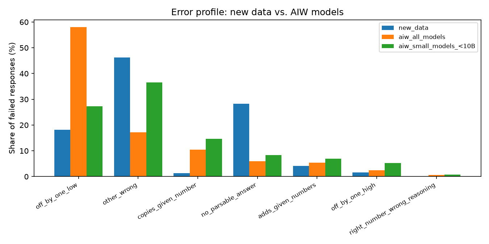

# Comparison: new responses vs. AIW reference

_Generated by `python -m llm_failure_mining.compare` from `ollama_llama3.2_3b.json`._

## Summary
| group | models | responses | accuracy | accuracy_siblings | off_by_one_share_of_sibling_failures | no_parsable_answer_share |
| --- | --- | --- | --- | --- | --- | --- |
| new_data | 1 | 315 | 0.025 | 0.0 | 0.193 | 0.276 |
| aiw_all_models | 75 | 49838 | 0.072 | 0.083 | 0.688 | 0.055 |
| aiw_small_models_<10B | 14 | 10840 | 0.043 | 0.053 | 0.339 | 0.08 |

## Error profile among failed responses
| error_type | new_data | aiw_all_models | aiw_small_models_<10B |
| --- | --- | --- | --- |
| off_by_one_low | 0.182 | 0.58 | 0.273 |
| other_wrong | 0.463 | 0.172 | 0.366 |
| copies_given_number | 0.013 | 0.105 | 0.147 |
| no_parsable_answer | 0.283 | 0.059 | 0.084 |
| adds_given_numbers | 0.042 | 0.054 | 0.069 |
| off_by_one_high | 0.016 | 0.025 | 0.053 |
| right_number_wrong_reasoning | 0.0 | 0.006 | 0.007 |

## Notes
- The new data has 315 responses. Shares based on few failures are uncertain.
- Correctness for collected data is automatic (parsed number equals the right answer). The AIW labels also include the authors' manual checks, so the two are not labelled in exactly the same way.
- A high `no_parsable_answer` share usually means the model ignored the `### Answer:` format, not that it reasoned worse.